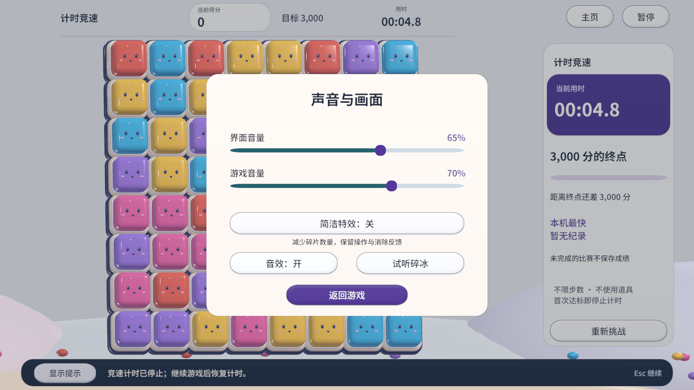
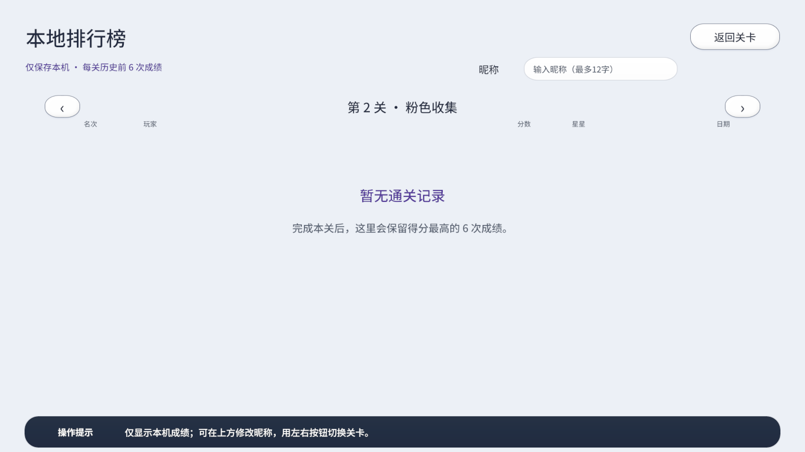
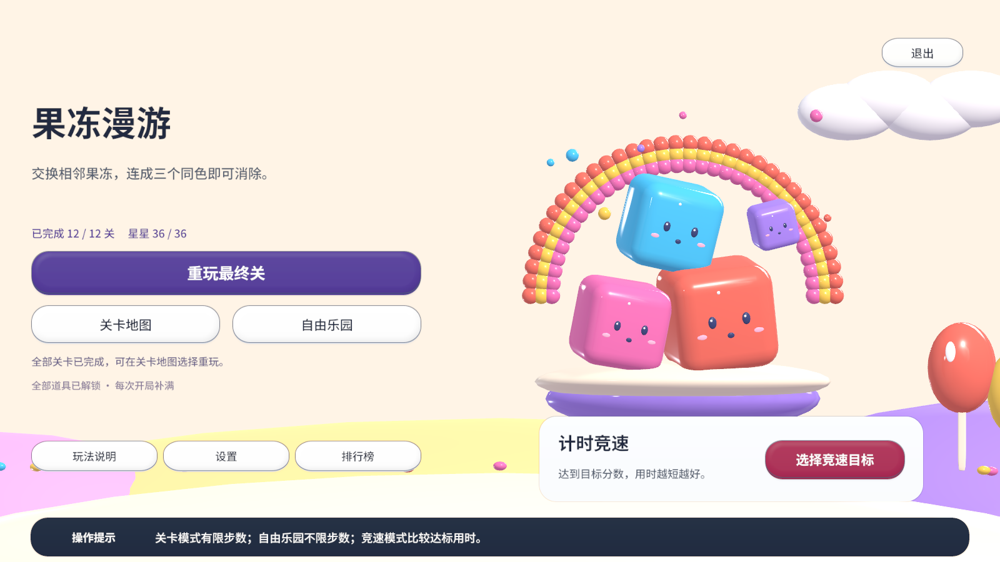

# 五次细节优化 · 2026-11-01

在 `feature/ui-race-mode` 上分别提交，不合并到 `main`。

## 1. 帮助窗口关闭行为

操作说明的主按钮改为「知道了」，关闭说明后保留当前页面，不再意外启动第 1 关。删除重复的返回按钮，保持窗口操作明确。

## 2. 音量滑块操作

扩大滑块手柄及可拖动区域，在细轨道周围也能调整音量；按 Unity 滑块的拉伸布局约束手柄高度，避免过高。保留原音量保存方式和百分比显示。

## 3. 排行榜空状态与昵称输入

没有成绩时说明如何产生和保存记录，区分关卡与自由乐园。昵称输入框增加边界、选中文字的反馈，以及清空时的「最多12字」提示；不改变原昵称保存规则。

## 4. 竞速结算对比

成绩页显示首次完成、与纪录持平，或比本机最快用时快／慢多少秒。对比使用与保存纪录一致的毫秒精度，帮助判断本次进步；不改变计时与排名规则。

## 5. 全部通关后的主页

全部关卡完成后，主页不再把最后一关写成「下一关」，改为说明可以选择重玩；继续按钮的悬停说明也切换为最终关重玩提示。正常进度下的入口和糖果背景保留。

## 验证

每个小版本通过 Unity MCP 刷新与编译检查，完成后统一运行真实棋盘与模式回归，并检查帮助、设置、排行榜、竞速结算和全部通关主页的实际渲染。新增检查确认帮助关闭不会重开关卡、首次竞速纪录有保存说明、全部通关提示及时更新。

测试会备份并恢复原存档；全部通关状态使用临时测试数据。完整执行记录在本机 `Captures/RaceUI/Verification.txt`。

[本次自动验证结果](verification/2026-11-01/checks.txt)

