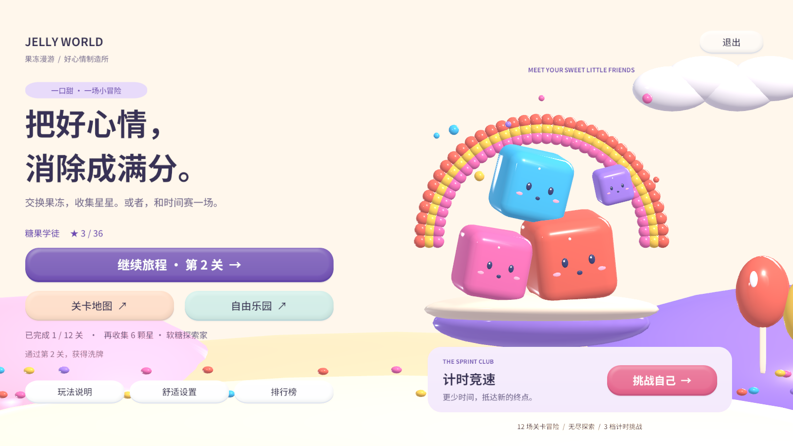
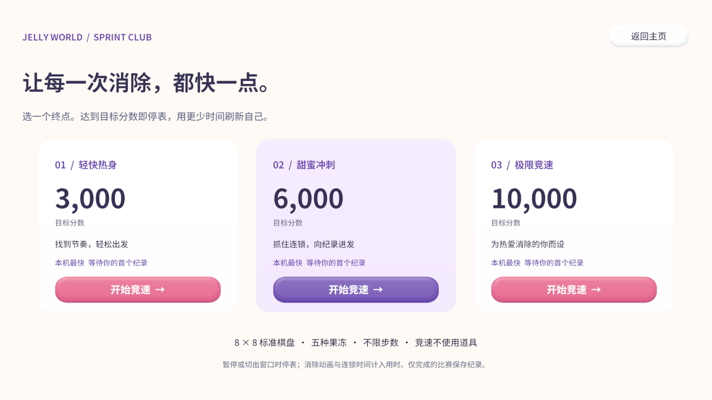
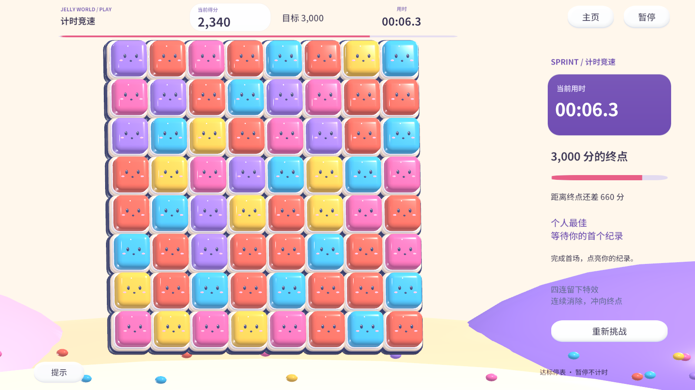

# 竞速与 UI 验收 · 2026-10-30

环境：Windows、Unity 6.3 LTS `6000.3.24f1`。使用 Unity MCP `v10.2.0` 连接当前工程，执行刷新、脚本编译、验证菜单及实际渲染。玩家存档在运行测试前备份，测试结束后恢复。

## 已验证

- Unity 脚本编译和 MCP Console 错误检查通过。
- 原有棋盘、关卡和成长规则检查通过。
- 单调实时时钟、暂停、重开、取消、无效时间戳、分钟／毫秒格式通过。
- 三档目标各自保存最快时间，较慢成绩不能覆盖纪录；结果显示与保存的毫秒值一致。
- 实际棋盘交换和连锁达到目标后进入成绩页，不消耗步数、不追加关卡奖励。
- 无效交换回退，分数和步数保持不变；竞速的道具、守护者和靶场入口均被阻止。
- 暂停和设置窗口停表，恢复后继续计时；达标后时间固定。
- 结果页重开从零开始，未完成退出不覆盖纪录；切换目标后独立计时。
- 竞速不会改变原关卡解锁、星星和排行榜；切回自由乐园与关卡后恢复各自规则。
- 首页、目标选择和竞速棋盘已检查 1600×900、1280×720、1024×768 中适用的实际截图，关键文字与按钮没有裁切或重叠。

验证菜单：`Jelly World/Verify race rules`、`Jelly World/Verify race and capture UI`。完整执行明细及截图位于本机忽略目录 `Captures/RaceUI`；可直接通过 MCP 再次运行。以上为编辑器运行验收，未生成新的 Windows 或 WebGL 发布包。

## 实际截图

