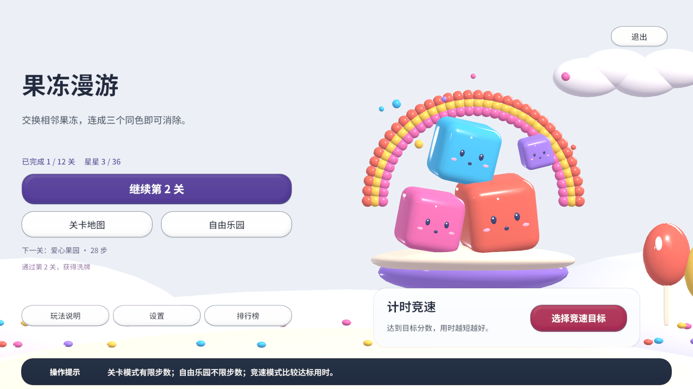
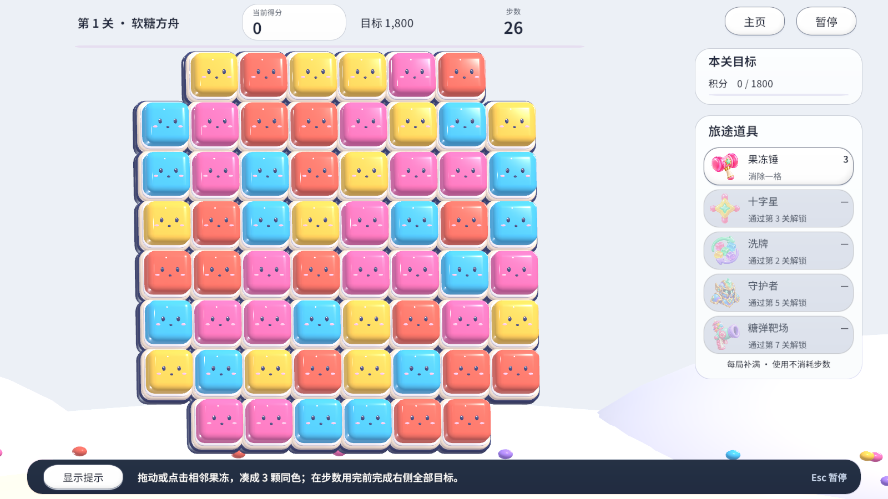
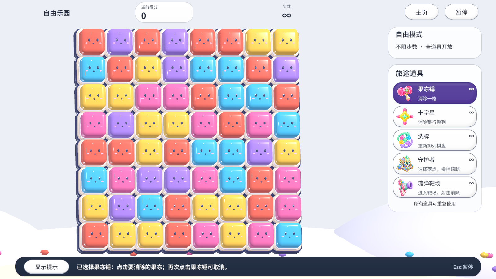
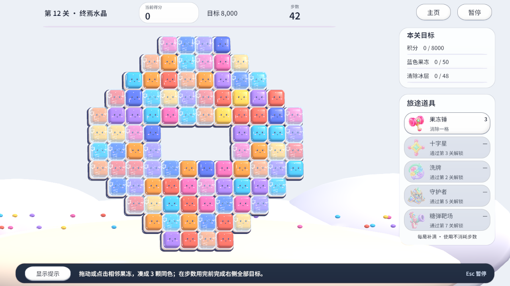

# UI 可读性与提示栏验收 · 2026-11-01

环境：Windows、Unity 6.3 LTS `6000.3.24f1`，通过本地 Unity MCP 进行刷新、编译和运行验证。原玩家存档在测试结束后恢复。

## 验证范围

- 编译与 Console 错误检查。
- 深色主按钮、描边次按钮、选中道具、锁定状态及右侧阅读底板的实际渲染。
- 主页和各模式的持续提示、按钮悬停、移开恢复、隐藏控件清理。
- 竞速禁止道具的说明、无效交换反馈，以及临时提示结束后恢复操作说明。
- 选中道具在临时提示结束后仍显示使用／取消方法；锁定关卡点击后保留解锁说明。
- 暂停时显示继续快捷键，守护者落点选择时显示取消快捷键。
- 多目标关卡的右侧布局与底部提示栏；1600×900、1280×720、1024×768 截图检查。
- 真实交换与连锁达标、暂停／设置停表、重开、纪录独立及关卡／自由模式切换。

通过菜单 `Jelly World/Verify race and capture UI` 可重复验收。本机完整执行明细和截图保存在忽略目录 `Captures/RaceUI`。本次未构建新的发布包。

[本次自动验证明细](checks.txt)

## 实际截图

