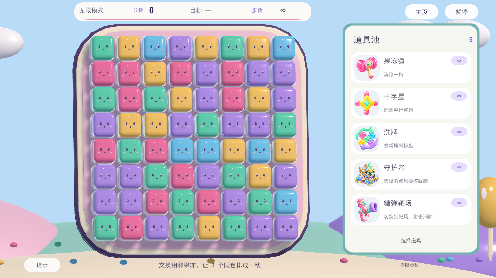

# ruanjian · Jelly World

课程小组协作的 Unity 益智消除游戏工程。

**当前是可在 Unity Editor 中运行的源码工程，还不是已发布的网页版。** 网页版需要安装 WebGL Build Support、导出构建，再部署到静态网站。仓库已包含导出菜单，见 [团队接手说明](Docs/TEAM_HANDOFF.md)。



## 本次地图与版本升级

本次更新把原先主要依靠棋盘尺寸区分的关卡，改成了类似传统三消游戏的独立整体地图。地图进一步放大到 **8×8～12×12**，每关只在地图轮廓内生成底座、果冻和冰层，地图缺口不会参与交换、匹配或目标统计。

| 关卡 | 地图 | 尺寸 | 有效格数 |
| --- | --- | ---: | ---: |
| 1 | 软糖方舟 | 8×8 | 60 |
| 2 | 爱心果园 | 8×8 | 42 |
| 3 | 冰晶钻石 | 9×9 | 41 |
| 4 | 糖沙漏 | 9×9 | 49 |
| 5 | 蝴蝶花园 | 10×10 | 80 |
| 6 | 甜甜圈岛 | 10×10 | 64 |
| 7 | 四叶糖花 | 11×11 | 72 |
| 8 | 薄荷王冠 | 11×11 | 85 |
| 9 | 双塔城堡 | 11×11 | 96 |
| 10 | 糖果星芒 | 12×12 | 92 |
| 11 | 双翼峡谷 | 12×12 | 112 |
| 12 | 终焉水晶 | 12×12 | 96 |

同步完成的改动：

- 关卡选择卡片增加地图缩略图、地图名称、有效格数、颜色数和步数。
- 放大棋盘在游戏画面中的占比，并随地图尺寸自动调整镜头，12×12 地图仍能完整显示。
- 步数提高到 26～42 步，目标分数提高到 1800～8000 分，同时增加冰层和颜色收集数量。
- 消除判定不能跨过地图缺口；每列只在有效格之间下落和补位。
- 果冻锤、十字星、洗牌、冰层、守护者移动和糖弹靶场全部适配异形地图。
- 关卡模板集中定义在 `Assets/JellyWorld/Scripts/JellyLevels.cs`，使用 `#` 表示有效格、`.` 表示缺口。
- 工程从 Unity `2022.3.42f1c1` 升级至 **Unity 6.3 LTS（6000.3.24f1）**，并更新包锁定文件和新版资源导入设置。
- 移除运行游戏不需要的 Unity MCP Git 依赖，将 `Newtonsoft Json` 改为明确的 Unity 官方包依赖。
- Unity 6 编译通过；规则检查覆盖 200 个普通棋盘和 360 个异形棋盘开局，验证地图连通、开局无现成匹配且存在合法交换。

## 打开工程

1. 安装 Git 和 Unity Hub，克隆仓库：

   ```bash
   git clone https://github.com/lyc20060601/ruanjian.git
   ```

2. 在 Unity Hub 中添加仓库根目录。工程版本为 **Unity 6.3 LTS（6000.3.24f1）**，记录在 `ProjectSettings/ProjectVersion.txt`。
3. 等待 Unity 还原依赖并导入素材，打开 `Assets/Scenes/JellyWorld.unity`，点击 Play。

已包含完整 `Assets`、`Packages`、`ProjectSettings` 和 `.meta` 文件，不需要原作者的 `Library` 缓存。

## 当前功能

- 12 个逐步解锁关卡：每关使用不同的整体地图轮廓，包括爱心、钻石、沙漏、蝴蝶、甜甜圈和水晶等，从 8×8 / 4 色逐步增加到 12×12 / 7 色。
- 积分、颜色收集和清冰目标；进度、星级、最高分保存。
- 相邻交换、三连消除、连锁、异形地图内补位、按住拖动及动画期间预输入。
- 果冻锤、十字光束、洗牌、守护者、糖弹靶场；无限模式。
- 守护者跑动、蓄力跳跃、第一／第三人称、两段碎冰。
- 独立靶场场景、糖弹射击、返回后同步棋盘。
- 本地排行榜、暂停、音效设置。

进度与排行榜是本机数据，不是联网账号或全服排行榜。

## 操作

| 场景 | 操作 |
| --- | --- |
| 棋盘 | 点击相邻两格，或按住鼠标拖动 |
| 守护者 | WASD 移动、Shift 跑动、空格蓄力跳跃、F 重踏 |
| 视角 | V 切换；第一人称移动鼠标；Tab 释放鼠标 |
| 靶场 | 鼠标瞄准，按住左键发射 |
| 暂停 | Esc |

## 协作与后续交付

每项工作新建分支，完成后通过 Pull Request 合并；场景、预制体与素材必须连同 `.meta` 提交。缓存和个人作业提交包不应进入仓库。

- [团队接手、模块划分与 WebGL 发布步骤](Docs/TEAM_HANDOFF.md)
- [玩法及实现说明](Assets/JellyWorld/README.md)
- [第三方素材和字体](THIRD_PARTY_NOTICES.md)
- [素材选用规则](AGENTS.md)

**网页版下一步：**安装 WebGL 模块 → 执行 `Jelly World > Build WebGL` → 浏览器验证 `Builds/WebGL` → 发布到 GitHub Pages 等静态托管服务。目前还没有浏览器游玩 URL。
