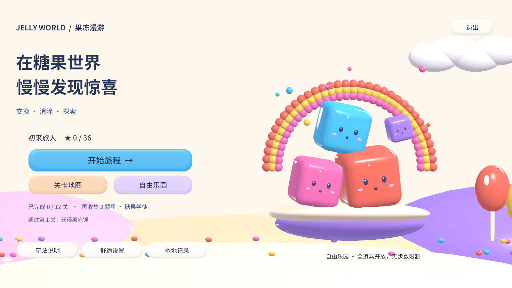
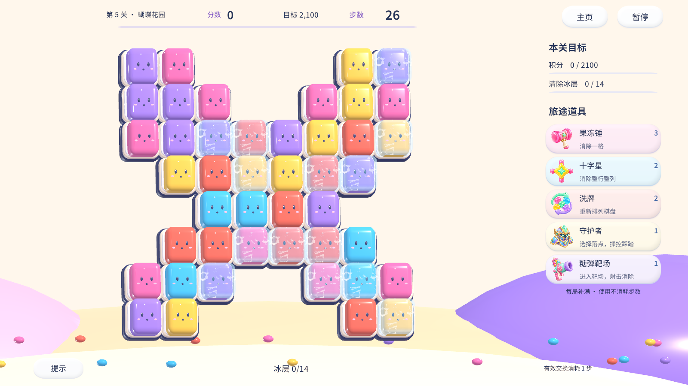

# Jelly World · 果冻漫游

Unity 单机三消游戏，包含异形关卡、道具成长、守护者探索和糖弹靶场。

当前分支为 **Unity 2022.3.42f1c1** 的可审查开发版本。开发按五个步骤整理，见 [任务与提交对照](Docs/DEVELOPMENT_2026-10-25.md)。



## 打开和试玩

1. 克隆仓库并切换到本开发分支：
   ```bash
   git clone https://github.com/lyc20060601/ruanjian.git
   cd ruanjian
   git switch feature/candy-journey-review
   ```
2. 用 Unity Hub 添加仓库根目录，使用 `ProjectSettings/ProjectVersion.txt` 指定的编辑器。
3. 等待依赖还原，打开 `Assets/Scenes/JellyWorld.unity`，点击 Play。
4. 导出 Windows：退出 Play Mode，执行 **Jelly World > Build Windows playtest**。输出为 `Builds/CandyOpen/JellyWorld.exe`；构建后可使用根目录 `试玩明亮糖果.bat`。

仓库提供源码与素材；缓存及生成的 Windows 程序不进入 Git。**克隆后需要先用 Unity 运行或构建。** WebGL 需要另装 Build Support 并单独验收，目前没有已发布的网页游玩链接。

## 当前体验

- 三个章节、12 个异形关卡：从 6×6 / 4 色逐步过渡到 10×10 / 7 色，组合积分、颜色收集和清冰目标。
- 进度、最佳星星与本地排行榜；成长按每关最佳星星累计，重复通关不会重复增加星星。
- 到达第 2/3/4/6/8 关分别解锁锤子、洗牌、十字星、守护者和靶场，每局补满。自由乐园全部开放。
- 连续拖动、落下时预输入、无效交换不扣步、暂停及音量/简洁特效设置。
- 暖白、蓝、粉、蜜桃和淡紫配色；立体地图预览、圆润按钮；主要信息直接排在场景背景上。



## 操作

| 场景 | 操作 |
| --- | --- |
| 棋盘 | 点击相邻两格，或按住鼠标拖动 |
| 守护者 | WASD 移动、Shift 跑动、空格蓄力跳跃、F 重踏 |
| 视角 | V 切换；第一人称移动鼠标；Tab 释放鼠标 |
| 靶场 | 鼠标瞄准，按住左键发射 |
| 暂停 | Esc |

## 检查与协作

- [开发任务、分步提交及审查重点](Docs/DEVELOPMENT_2026-10-25.md)
- [团队接手、验证命令与构建方式](Docs/TEAM_HANDOFF.md)
- [本次验收记录](Docs/verification/2026-10-25/RESULTS.md)
- [模块与玩法说明](Assets/JellyWorld/README.md)
- [素材来源与授权](THIRD_PARTY_NOTICES.md) · [素材规则](AGENTS.md)

`feature/unique-level-maps-unity6` 保持独立。本分支移植其中的地图玩法，并保留 2022.3 工程与较温和的关卡参数。
